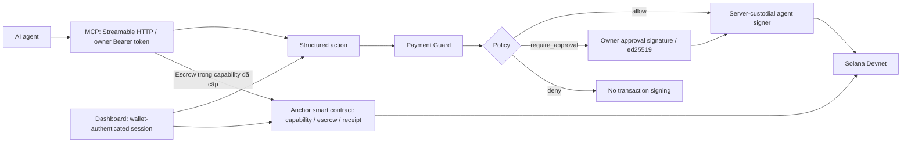

<p align="center">
  
</p>

<h1 align="center">nexusPay</h1>
<p align="center"><strong>Kiểm soát chi tiêu của AI agent trên Solana.</strong><br />Payment Guard và Task Vault cho AI agent trên Solana Devnet.</p>
<p align="center">
  <a href="https://nexuspay-56wn.onrender.com">Thử demo</a> ·
  <a href="#chạy-local">Chạy local</a> ·
  <a href="docs/mcp-troubleshooting.md">Hướng dẫn MCP</a> ·
  <a href="#phạm-vi-và-giới-hạn">Phạm vi và giới hạn</a>
</p>

[](https://github.com/thanhhau15112000-dev/NexusWallet/actions/workflows/ci.yml)
[](LICENSE)

nexusPay kiểm tra yêu cầu chuyển tiền của AI agent theo chính sách chi tiêu: ví agent ký giao dịch được phép, yêu cầu vượt hạn mức chờ chủ ví ký duyệt, người nhận ngoài danh sách cho phép bị từ chối. Dự án là **demo Devnet**, chưa được audit bảo mật độc lập và chưa dành cho tài sản thật.

## Hai luồng thanh toán

| | Payment Guard | Task Capability Vault |
| --- | --- | --- |
| Mục đích | Chuyển SOL/SPL từ ví agent theo chính sách chi tiêu | Cấp ngân sách SOL hoặc SPL token (Token program) riêng cho từng tác vụ |
| Authorization / policy enforcement | Backend: `evaluatePolicy` và owner approval signature | Anchor smart contract: capability, budget, expiry, worker/service allowlist |
| Key custody / signing authority | Server-custodial agent keypair, AES-256-GCM encryption at rest | Owner tạo capability; agent signer và worker signer có authority theo instruction |
| Kết quả | Giao dịch được thực hiện, chờ duyệt hoặc bị từ chối | SOL hoặc SPL token được giữ trong Escrow; output qua kiểm tra cấu trúc cố định (`verifyTaskOutput`, tối đa 3 lượt nộp nếu từ chối) và cần owner ký nghiệm thu trước khi trả Worker |
| Trust boundary | Backend runtime, agent signer và persistent state | Deployed smart contract và upgrade authority; kiểm tra output tự động chỉ kiểm tra cấu trúc cố định, không chứng minh chất lượng công việc độc lập |

Hai luồng có enforcement boundary khác nhau. Payment Guard là off-chain policy enforcement, không phải on-chain smart contract. Task Vault là Anchor smart contract với capability-based authorization; nó không thay đổi custody model của agent wallet thành non-custodial.

### Vì sao Solana

- **PDA (Program Derived Address):** mỗi task có capability PDA (`["capability", owner, task_id]`), vault PDA và escrow/receipt PDA. Program kiểm tra quyền trên các account này.
- **Signer authorization:** owner create/fund và revoke task, `agent_signer` execute payment, worker settle escrow. Smart contract kiểm tra signer constraint của từng instruction.
- **SOL và SPL Token:** Payment Guard và Task Vault đều hỗ trợ cả hai. Allowlist mint giới hạn loại SPL token agent được chuyển; ngân sách Task Vault bằng token nằm trong associated token account của vault PDA và chỉ dùng Token program (không nhận Token-2022).
- **Rent và account lifecycle:** program đóng account ở các bước settle/refund/close tương ứng để hoàn rent. Escrow còn chờ phải được xử lý trước khi đóng task.
- **Permissionless refund:** sau expiry, caller bất kỳ có thể gửi instruction hoàn escrow về owner; không cần server nexusPay ký thay owner.

## Thử trong vài phút

1. Bật **Testnet Mode** trong Developer Settings của Phantom và chọn Solana Devnet.
2. Mở [dashboard](https://nexuspay-56wn.onrender.com), kết nối ví và ký tin nhắn đăng nhập. Bước này không chuyển tiền.
3. Lấy SOL thử nghiệm từ [Solana Faucet](https://faucet.solana.com), nạp cho ví agent hiển thị trên dashboard.
4. Đặt người nhận được phép, mức tối đa mỗi giao dịch và ngưỡng SOL trong 24 giờ ở tab **Chính sách chi tiêu**.
5. Mở **Thử lệnh** để nhập lệnh, hoặc kết nối ứng dụng AI qua card MCP trên tab **Tổng quan**.

| Đề xuất của agent | Kết quả dự kiến |
| --- | --- |
| Người nhận được phép, trong hạn mức | `allow`: ví agent tự ký |
| Vượt mức mỗi giao dịch hoặc ngưỡng SOL 24 giờ | `require_approval`: chủ ví ký duyệt, hoặc hủy |
| Người nhận ngoài danh sách | `deny`: không có đường duyệt |
| Agent đang bị khóa | `AGENT_FROZEN`: chặn đường ký chuyển giá trị của server |

Daily cap trong rolling 24-hour window là **approval threshold**, không phải hard cap: owner có thể approve transfer vượt ngưỡng. Pruning giữ SOL/SPL transfer đã hoặc có thể đã chuyển tiền trong 24 giờ, cùng request in-flight; idempotency không được bảo đảm vô thời hạn. Xem [phạm vi và giới hạn](#phạm-vi-và-giới-hạn).

### Các màn hình trên dashboard

| Màn hình | Nhóm | Chức năng |
| --- | --- | --- |
| Tổng quan | Thiết lập | Xem số dư ví agent/chủ sở hữu, hạn mức, yêu cầu chờ duyệt; nạp 0.1 SOL từ ví chủ sở hữu hoặc mở Solana Official Faucet; khóa/mở khóa agent; card **Kết nối ứng dụng AI qua MCP** (lấy URL `/mcp`, cấu hình Claude Code / Codex / Antigravity, tạo/đổi token) |
| Chính sách chi tiêu | Thiết lập | Cấu hình hạn mức SOL mỗi giao dịch và ngưỡng 24 giờ, allowlist người nhận và SPL mint kèm hạn mức mỗi giao dịch theo mint |
| Thông báo | Thiết lập | Liên kết bot Telegram cá nhân (tùy chọn) để nhận cảnh báo một chiều (chờ duyệt, bị chặn, thất bại, thành công, duyệt hết hạn), bật/tắt chế độ im lặng và chọn ngôn ngữ tin nhắn EN/VI. Không ký hay duyệt giao dịch trong Telegram |
| Duyệt yêu cầu | Hoạt động | Xem danh sách yêu cầu, ký duyệt giao dịch vượt hạn mức bằng ví chủ sở hữu hoặc hủy yêu cầu đang chờ |
| Task Vault | Hoạt động | Tạo và nạp ngân sách tác vụ bằng SOL hoặc SPL token được allowlist (Devnet mặc định hoặc Mô phỏng), tạo Escrow, chạy Worker bàn giao output (merchant demo cho Devnet hoặc Mock Worker), xem báo cáo kiểm tra output, từ chối kèm lý do (tối đa 3 lượt nộp), ký nghiệm thu trước quyết toán, thu hồi quyền chi, hoàn Escrow hết hạn và đóng Task Vault |
| Lịch sử | Hoạt động | Xem lịch sử giao dịch SOL vào/ra ví agent (kèm liên kết Solana Explorer) và **Nhật ký kiểm toán** (append-only, payload mã hóa AES-256-GCM) |
| Thử lệnh | Hoạt động | Nhập yêu cầu bằng ngôn ngữ tự nhiên hoặc chạy lệnh gợi ý (`get_balance`, `transfer_sol`, `transfer_spl`) |
| Tài liệu | Hướng dẫn | Hướng dẫn sử dụng, tích hợp MCP, x402, thông báo Telegram và xử lý lỗi ngay trong dashboard |

Giao diện mặc định là tiếng Việt, có lựa chọn tiếng Anh. Các thuật ngữ như Task Vault, Escrow, Receipt, Worker, MCP, hash và rent được giữ bằng tiếng Anh để khớp với API và smart contract.

## Kiến trúc



- MCP gửi structured action trực tiếp; tab **Thử lệnh** chuyển nội dung nhập thành action qua model hoặc deterministic parser. Model không nhận private key.
- Hosted mode tạo context riêng cho từng ví owner. MCP token gọi được 9 route API: đọc trạng thái, request và task, đề xuất transfer/x402 (`intents`, `x402/resolve`, `x402/fetch`), tạo Escrow trong capability đã cấp. Tạo/nạp task, sửa chính sách, cài đặt thông báo Telegram, ký duyệt, từ chối/nghiệm thu output, thu hồi quyền, settlement, refund (kể cả hoàn Escrow hết hạn) và khóa/mở khóa vẫn cần phiên ví chủ sở hữu.
- Owner approval signature bind request, amount, recipient, policy version, nonce và TTL. Approval TTL mặc định là 300 giây; authentication session TTL mặc định là 30 phút. Wallet authentication và transaction authorization là hai flow riêng.
- JSON Store persist qua temporary file + rename; audit payload dùng AES-256-GCM và SHA-256 hash chaining. Đây là server-side state, không phải immutable on-chain ledger.

### Đặc tính kỹ thuật

| Đặc tính | Triển khai và phạm vi |
| --- | --- |
| **Streamable HTTP / Bearer token** | Remote MCP tại `/mcp`, token theo owner; bản local có transport stdio. Hosted chỉ lưu `sha256(token)`, so khớp bằng `timingSafeEqual`, token chỉ hiển thị một lần khi tạo |
| **ed25519** | Signature verification cho owner `signMessage` trong authentication và approval; approval bind request, nonce, policy version và TTL |
| **AES-256-GCM** | Encryption at rest cho agent private key và audit payload; không bảo vệ khỏi runtime compromise |
| **Append-only / SHA-256 hash chaining** | Audit append entry và bind previous-entry hash; cần integrity verification, không cung cấp immutability trước server có quyền rewrite toàn bộ file |
| **Idempotency** | Với structured transfer action, `idempotencyKey` nhận diện retry cùng action; key khác action trả `IDEMPOTENCY_CONFLICT` khi record còn được giữ lại |
| **Retention / rolling 24-hour window** | Request retention mặc định là 200. Khi prune, giao dịch SOL/SPL đã hoặc có thể đã chuyển tiền trong 24 giờ và request chưa kết thúc được giữ lại, nên SOL spending accounting và idempotency key của chúng không mất trong cửa sổ 24 giờ ([store.test.ts](agent/test/store.test.ts)) |
| **Deterministic fallback parser** | Tab **Thử lệnh** dùng deterministic parser khi không dùng model provider; action vẫn qua schema validation và `evaluatePolicy` |
| **Rate limit** | Fixed-window limit theo route: đăng nhập (`POST /api/auth/challenge`, `POST /api/auth/login`) 10/phút/IP cho từng route; đề xuất chi tiêu (`POST /api/agent/intents`, `POST /api/agent/x402/resolve`, `POST /api/agent/x402/fetch`, `POST /api/tasks/:taskId/payments`, `POST /api/commands`) dùng chung 30/phút/owner trong mỗi loại danh tính (session hoặc MCP token); endpoint `POST /mcp` 600/phút/owner (backstop); các route `/api/*` còn lại 240/phút/owner. Vượt giới hạn trả `RATE_LIMITED` kèm `retryAfterSeconds`. Counter rate limit nằm trong memory, reset khi restart; không thay thế WAF/CDN |
| **Thông báo Telegram (tùy chọn)** | Bot một chiều theo owner (`telegram.ts`), liên kết qua link token 10 phút lưu trong memory. Local dùng long-polling (`getUpdates`), hosted dùng webhook `/api/webhooks/telegram` xác thực `X-Telegram-Bot-Api-Secret-Token`. Hỗ trợ 5 sự kiện (`pendingApproval`, `txDenied`, `txFailed` bật mặc định; `txConfirmed`, `approvalExpired` tắt mặc định), `silent` và ngôn ngữ EN/VI. Gửi best-effort không có retry queue; `approvalExpired` chỉ phát khi đọc request (lazy expiration); không hỗ trợ duyệt/ký trong Telegram |
| **Health & Readiness** | `GET /api/health` trả trạng thái process và `commit`; `GET /api/health/ready` kiểm tra Devnet RPC (`getSlot('confirmed')`, cache 15 giây, trả `200` hoặc `503`) |
| **Multi-tenant / single-instance** | Context riêng theo owner; Store JSON và session hiện phục vụ một instance, chưa có transaction chung cho nhiều replica |

Nguồn: [`crypto.ts`](agent/src/crypto.ts), [`audit.ts`](agent/src/audit.ts), [`pipeline.ts`](agent/src/pipeline.ts), [`mcp-remote.ts`](agent/src/mcp-remote.ts), [`store.ts`](agent/src/store.ts), [`rate-limit.ts`](agent/src/rate-limit.ts), [`mcp-token.ts`](agent/src/mcp-token.ts), [`telegram.ts`](agent/src/telegram.ts), [`rpc-probe.ts`](agent/src/rpc-probe.ts), [`merchant-worker.ts`](agent/src/merchant-worker.ts), [`x402.ts`](agent/src/x402.ts).

### Cấu trúc repo

| Thư mục | Trách nhiệm |
| --- | --- |
| [`shared/src`](shared/src) | Action schema, monetary units, approval message, policy, x402, notifications schema và Task Vault state machine |
| [`agent/src`](agent/src) | API, session/owner context, pipeline, signer, x402, thông báo Telegram, readiness check, merchant worker client, lưu trữ, audit và remote MCP |
| [`mcp/src`](mcp/src) | Công cụ MCP gọi API agent; không giữ key và không trực tiếp gọi chain |
| [`demo-merchant/src`](demo-merchant/src) | Cloudflare Worker demo: endpoint HTTP 402 (x402 v2) và Task Vault worker tự giữ key ký output/settlement |
| [`programs/nexus-task-vault`](programs/nexus-task-vault) | Anchor smart contract: capability-based authorization, budget enforcement, escrow và receipt |
| [`web/src`](web/src) | Dashboard React, tiếng Việt mặc định (kể cả tab Docs) và lựa chọn tiếng Anh |
| [`extension`](extension) | Chrome extension mở dashboard |
| [`infra`](infra) | Docker và cấu hình triển khai |
| [`agent/test`](agent/test), [`mcp/test`](mcp/test), [`demo-merchant/test`](demo-merchant/test) | Kiểm thử policy, approval, pipeline, routes, Telegram, Task Vault, demo merchant và MCP |

Điểm vào chính: [`pipeline.ts`](agent/src/pipeline.ts), [`policy.ts`](shared/src/policy.ts), [`approvals.ts`](agent/src/approvals.ts), [`task-vault-chain.ts`](agent/src/task-vault-chain.ts). RPC cho chuyển SOL/SPL và RPC cho Task Vault nằm ở các module riêng.

## Kết nối MCP

Endpoint hosted: `https://nexuspay-56wn.onrender.com/mcp`. Đăng nhập dashboard rồi sao chép cấu hình theo client từ card MCP trên tab **Tổng quan**. Hosted mode chỉ hiển thị token một lần khi tạo hoặc đổi token, server lưu hash SHA-256. Local mode giữ token trên disk để stdio client đọc cấu hình. Token là mã truy cập bí mật; không đưa vào issue, ảnh chụp hoặc repo. Đổi token sẽ ngắt các client dùng token cũ.

MCP hiện cung cấp **10 tool** cho Payment Guard, x402 và Task Vault:

| Tool | Chức năng |
| --- | --- |
| `nexuspay_get_status` | Ví agent, số dư, policy, mức SOL đã chi và trạng thái khóa |
| `nexuspay_list_requests` | Danh sách yêu cầu và kết quả xử lý |
| `nexuspay_get_request` | Chi tiết một yêu cầu, trạng thái duyệt và link Explorer nếu có |
| `nexuspay_transfer_sol` | Đề xuất chuyển SOL qua Payment Guard |
| `nexuspay_transfer_spl` | Đề xuất chuyển SPL token; cần allowlist recipient/mint và hạn mức tương ứng |
| `nexuspay_x402_fetch` | Gọi URL HTTP 402 theo chuẩn x402 v2 (`exact`, SPL trên Solana Devnet), ký qua Payment Guard và gửi `PAYMENT-SIGNATURE` |
| `nexuspay_x402_resolve` | Đánh giá và ký challenge x402 v2 (không tự broadcast), trả về header `PAYMENT-SIGNATURE` và `idempotencyKey` |
| `nexuspay_list_tasks` | Danh sách Task Vault, capability, ngân sách còn lại, cap và expiry từ record local |
| `nexuspay_get_task` | Chi tiết task, Escrow và Receipt; phân biệt mô phỏng/Devnet, chưa reconcile lại chain |
| `nexuspay_execute_task_payment` | Tạo Escrow trong capability chủ ví đã cấp; Worker nhận tiền ở bước settlement riêng |

MCP token không có quyền sửa chính sách, cài đặt thông báo Telegram, ký duyệt, tạo/nạp/revoke/refund task, chạy Mock Worker, từ chối/nghiệm thu output hoặc settlement. Chủ ví tạo và nạp Task Vault trên dashboard trước khi agent sử dụng ngân sách được cấp.

Nếu kết quả là `outcome_unknown`, đối chiếu request và Explorer; retry cùng action với **cùng** `idempotencyKey`. Hai key khác nhau được xem là hai đề xuất. Nếu nhận `RATE_LIMITED`, chờ `retryAfterSeconds` rồi retry với cùng key, không đổi số tiền. Cơ chế này không bảo đảm idempotency vô thời hạn khi request record đã bị prune.

**Task Vault qua MCP:** owner tạo và nạp task trên dashboard; agent gọi `nexuspay_list_tasks` rồi `nexuspay_get_task` để đọc quyền đã cấp. Tạo escrow bằng `nexuspay_execute_task_payment` với `taskId`, `paymentId`, địa chỉ `worker`, `serviceId`, `amountLamports` (số nguyên theo base unit của tài sản task: lamports với SOL, 1 SOL = 1.000.000.000; base unit của mint với token, 1 USDC = 1.000.000) và `requestHash` (SHA-256 hex thường, 64 ký tự). MCP không tạo/nạp task, đổi quyền, revoke, chạy mock worker, settle hay refund.

Mỗi khoản dùng một `paymentId` riêng trong task. Retry khoản đã có record với cùng tham số trả record đó và `reused: true`; đổi tham số trả `IDEMPOTENCY_CONFLICT`. Nếu nhận `outcome_unknown`, đọc lại task và **giữ nguyên paymentId cùng tham số**. Nếu vẫn thiếu record, owner cần đối chiếu escrow Devnet trước khi bắt đầu khoản khác; đường này chưa tự khôi phục record khi chain đã nhận giao dịch nhưng API mất kết quả. Trường `mode: simulated` chỉ là mô phỏng, không chuyển SOL. Trên Devnet, worker là merchant demo (giữ key riêng, tự ký output và settlement) hoặc mock worker do server giữ key; receipt không chứng minh chất lượng công việc.

Kiểm tra owner, agent signer hiện tại và task chưa đóng áp dụng cho cả simulated lẫn Devnet; đây là chủ ý để mô phỏng không bỏ qua quyền được cấp. Record simulated lệch signer (ví dụ sau khi thay ví agent) bị từ chối; cần tạo task simulated mới. MCP không tự sửa signer trên task cũ.

Lỗi đọc task trước bước POST không được báo `outcome_unknown`. Sau khi bắt đầu POST, lỗi mạng/5xx vẫn được xử lý thận trọng: API hiện trả cùng `onchain_payment_failed` cho lỗi trước khi gửi và lỗi chưa rõ xác nhận, nên chưa phân loại được hai trường hợp đó. Khi ghi record, cập nhật spent và payment vẫn là hai lần ghi riêng; chưa có khôi phục tự động nếu lần ghi sau thất bại.

Task payment, transfer intent, x402 resolve/fetch và lệnh từ tab **Thử lệnh** (`/api/commands`) dùng chung trần 30 yêu cầu/phút theo loại danh tính và owner đã xác thực; đổi task hoặc route không tạo quota mới. Session dashboard và token MCP có bucket riêng, nên đây không phải trần chung 30 yêu cầu/phút cho mọi cách truy cập của một owner.

Local có bản stdio: chạy `pnpm mcp:build`, sau đó `pnpm mcp:install -- --client codex`. Thay `codex` bằng `claude-desktop` hoặc `antigravity` để cấu hình client tương ứng. Cấu hình và lỗi theo client: [MCP troubleshooting](docs/mcp-troubleshooting.md).

### Kịch bản demo Payment Guard

Đặt `Max per transaction = 0.1 SOL`, `Max per day = 0.2 SOL`, thêm recipient `my-wallet` vào allowlist và nạp đủ SOL Devnet kể cả phí mạng.

1. Gửi `0.05 SOL` đến `my-wallet`: `allow`, kiểm tra `execution.explorerUrl`.
2. Gửi `0.5 SOL` đến `my-wallet`: `require_approval`; owner ký duyệt trong TTL hoặc cancel.
3. Gửi đến recipient ngoài allowlist: `RECIPIENT_NOT_IN_ALLOWLIST`, không có đường approval.
4. Nếu bước 2 đã được duyệt, gửi thêm khoản nhỏ: `DAILY_LIMIT_EXCEEDED`, vì khoản đã duyệt cũng được tính vào rolling 24-hour window; pruning bảo vệ record cần cho cửa sổ này.
5. Bật kill switch rồi đề xuất transfer: `AGENT_FROZEN`. MCP không có tool tự unfreeze hoặc thay policy.

MCP trả `code`, `message`, `remediation` và `details` cho error/pending approval. `details` dùng SOL và lamports; pending request có `pollIntervalMs` và `dashboardUrl`. Ví dụ này kiểm tra hành vi trong retention hiện tại, không chứng minh idempotency hoặc daily cap enforcement ngoài retention window.

### Thanh toán x402 (v2, `exact`, SPL trên Solana Devnet)

- **Chuẩn hỗ trợ:** x402 v2, scheme `exact`, SPL token trên Solana Devnet (`solana:EtWTRABZaYq6iMfeYKouRu166VU2xqa1`). Challenge đọc từ header `PAYMENT-REQUIRED` (hoặc body JSON); option phải có `extra.feePayer`. Mainnet và challenge v1 bị từ chối.
- **Ký và chống trả hai lần:** facilitator trong `extra.feePayer` là fee payer; agent chỉ ký phần của mình cho giao dịch `SetComputeUnitLimit(40_000)`, `SetComputeUnitPrice(1)`, `TransferChecked`, `Memo` (`extra.memo` hoặc nonce ngẫu nhiên), **không tự broadcast**, gửi qua header `PAYMENT-SIGNATURE`. Agent không cần SOL để trả phí x402. Mã giao dịch là chữ ký của facilitator nên agent nhận diện khoản thanh toán bằng chữ ký của chính nó: retry dùng lại giao dịch cũ khi blockhash còn hiệu lực và chỉ ký giao dịch mới khi đã `expired` mà không tìm thấy trên chain. Request chỉ chuyển `confirmed` khi một giao dịch chứa chữ ký của agent đã `confirmed` trên chain; gọi lại bằng `idempotencyKey` của khoản đã `confirmed` thì không gửi gì và trả về `X402_ALREADY_PAID` (muốn mua lại thì dùng key mới).
- **Policy & approval:** đi qua policy `transfer_spl` (`payTo` trong `allowedRecipients`, `asset` trong `allowedMints`, hạn mức `maxTokenAmountByMint`). Khoản vượt cap dừng ở `pending_approval`; sau khi chủ ví duyệt, request giữ trạng thái `approved` (chờ thanh toán) và agent gọi lại với **cùng** `idempotencyKey` để ký và gửi `PAYMENT-SIGNATURE`.
- **Demo merchant (`demo-merchant/`):** Cloudflare Worker dùng facilitator miễn phí `https://x402.org/facilitator` (`/supported` để lấy fee payer, rồi `/verify` và `/settle`), trả 200 kèm `PAYMENT-RESPONSE`, đọc lịch sử thanh toán trực tiếp từ ATA USDC của merchant trên Devnet. Chạy local với `pnpm demo:merchant`; ví agent cần USDC Devnet, ví merchant cần có sẵn ATA USDC, và URL gọi từ `nexuspay_x402_fetch` phải là URL công khai (SSRF guard chặn localhost/private IP).

## Task Capability Vault

**Task Vault** tách ngân sách tác vụ khỏi số dư dùng cho Payment Guard, hỗ trợ SOL hoặc SPL token nằm trong allowlist (chỉ Token program, không nhận Token-2022). Trong chế độ Devnet, ngân sách nằm trong vault PDA của program; agent chỉ được tạo Escrow theo capability đã cấp. Chuyển tiền vào Escrow chưa có nghĩa Worker đã nhận tiền: output cần được bàn giao, kiểm tra cấu trúc và được owner ký nghiệm thu trước khi quyết toán.

Program Devnet: [`3N4GYuQXvqhDeFKLWh4GiXdD3pr3PWcNRtkUyxSYPaUK`](https://explorer.solana.com/address/3N4GYuQXvqhDeFKLWh4GiXdD3pr3PWcNRtkUyxSYPaUK?cluster=devnet).

| Chế độ trên dashboard | Hành vi |
| --- | --- |
| Devnet | Ví chủ sở hữu ký giao dịch tạo/fund task. Mặc định chọn merchant demo làm Worker nếu `MERCHANT_WORKER_URL` khả dụng (ngược lại dùng Mock Worker). Backend gửi payment và settlement bằng signer được cấp quyền. Các giao dịch cần SOL thử nghiệm để trả amount, network fee và rent |
| Mô phỏng | Ghi trạng thái task, Escrow và Receipt vào Store để thử luồng (dùng Mock Worker). Không chuyển tiền và không tạo account on-chain; số tiền hoàn hiển thị là kết quả mô phỏng |

Worker của task là merchant demo hoặc Mock Worker; ví nhận khi settlement là địa chỉ Worker của Escrow. Merchant demo (Cloudflare Worker, cấu hình qua `MERCHANT_WORKER_URL`) giữ key worker riêng, tách khỏi ví nhận USDC của x402: nó chỉ nhận việc và ký đồng thời settlement khi Escrow đang giữ trên Devnet cho chính key đó. Backend giữ signer của Mock Worker. Worker bàn giao output JSON và ký hash của chính nội dung đó; bước bàn giao chưa trả tiền. Khi nhận output, server chạy `verifyTaskOutput` kiểm tra 5 quy tắc cấu trúc cố định (`status_ok`, `service_match`, `content_present`, `timestamp_valid`, `request_binding`): nếu không đạt thì chặn settlement; chủ ví có thể từ chối kèm lý do để mở tối đa **3 lượt nộp lại** (`MAX_DELIVERY_ATTEMPTS = 3`) trước khi task hết hạn (hash output đã bị từ chối không được nộp lại). Đây là kiểm tra cấu trúc tự động cố định, **không phải** kiểm định chất lượng nội dung độc lập. Với output hợp lệ, chủ ví kiểm tra, xác nhận nghiệm thu và ký thông điệp gắn với program, task, Escrow, request hash, output hash và số tiền trước khi quyết toán. Receipt ghi nhận output đã được chủ ví chấp nhận; không chứng minh chất lượng được kiểm tra độc lập hay một dịch vụ bên ngoài đã thực hiện tác vụ.

**Yêu cầu cập nhật program:** source dùng instruction mới `settle_accepted_output` và bỏ entrypoint worker-only `settle_with_receipt`. Client mới không quyết toán được trên program cũ. Cần build và cập nhật program cùng API/UI trước khi sử dụng luồng mới trên Devnet; thay đổi source không chứng minh bản deployed đã cập nhật. Layout capability, Escrow và Receipt không đổi. Record cũ chưa có output bàn giao phải bổ sung output trước khi nghiệm thu; Receipt lịch sử không được coi là đã có chữ ký nghiệm thu của owner.

| Instruction | Signer authorization và state transition |
| --- | --- |
| `create_and_fund_task` | Owner tạo capability PDA + vault PDA, fund `budget`, đặt `per_payment_cap`, `expiry` và worker/service allowlist |
| `execute_task_payment` | `agent_signer` tạo escrow PDA; enforce budget, per-payment cap, expiry và worker/service allowlist |
| `settle_accepted_output` | Worker signer submit `result_hash`; program yêu cầu native Ed25519 verification của chữ ký nghiệm thu owner cho đúng output, Escrow, request và amount trước khi giải ngân và tạo Receipt |
| `revoke_task` | Owner revoke capability; reject payment mới, không cancel held escrow |
| `refund_expired_escrow` | Sau expiry, bất kỳ caller nào cũng có thể hoàn escrow về owner |
| `refund_and_close` | Hoàn phần dư về owner và đóng task khi không còn escrow chờ; sau expiry/revoke không cần owner ký |
| `close_receipt` | Khi task không còn active hoặc đã hết hạn, owner/Worker có thể đóng Receipt; rent về Worker. Nếu capability đã đóng, chỉ Worker được đóng Receipt |

Demo nên đi theo thứ tự: tạo task → tạo Escrow → bàn giao output → kiểm tra kết quả xác minh (tùy chọn từ chối để Worker nộp lại tối đa 3 lượt) → owner kiểm tra và ký nghiệm thu → quyết toán → thu hồi quyền chi → kiểm tra payment mới bị chặn → hoàn Escrow hết hạn (nếu còn) → hoàn phần dư và đóng Task Vault. Escrow đã tạo trước khi thu hồi quyền vẫn quyết toán được khi có chữ ký nghiệm thu owner và task chưa hết hạn. Thu hồi quyền chi không hoàn tiền ngay và không hủy Escrow đang giữ.

**Hạn chế đã biết:** kiểm tra tự động chỉ kiểm tra cấu trúc JSON cố định; chất lượng nội dung được owner kiểm tra thủ công. Dù đã có luồng từ chối/nộp lại tối đa 3 lượt, hệ thống vẫn chưa có thời hạn nghiệm thu riêng, tự động giải ngân khi im lặng hoặc phân xử tranh chấp. Owner vẫn có thể từ chối nghiệm thu; khi task hết hạn, held Escrow vẫn có thể hoàn về owner bằng `refund_expired_escrow`. Vì vậy hệ thống chưa bảo vệ worker khỏi việc bên thuê nhận output rồi từ chối hoặc trì hoãn thanh toán. Nạp Escrow và có chữ ký Worker không được coi là bằng chứng output đạt chất lượng.

Task hết hạn không thể tạo payment hoặc settlement mới. Nếu vẫn còn Escrow đang giữ, owner có thể hoàn từng Escrow hết hạn ngay trên dashboard (ký giao dịch `refund_expired_escrow` và đồng bộ qua `POST /api/tasks/:taskId/payments/:paymentId/refund-expired`) trước khi đóng Task Vault. Dashboard hiển thị cảnh báo và chặn đóng task khi còn Escrow đang giữ. Sau khi task đóng, dashboard không ký thay Worker để thu hồi rent của Receipt.

## Bằng chứng và kiểm thử

```bash
pnpm test    # unit và integration cho @nexus/agent, @nexus/mcp và @nexus/demo-merchant; một số test cần local validator
pnpm build   # Vite bundle + TypeScript toàn workspace
pnpm mcp:build # bundle MCP stdio
```

| Bằng chứng | Phạm vi chứng minh | Giới hạn |
| --- | --- | --- |
| Release [#93](https://github.com/thanhhau15112000-dev/NexusWallet/pull/93), ngày 09/10/2026 | Staging #91/#92 cùng thay đổi UI/copy đã vào `main` tại `84f0619e9a3698164945986ddac82e67c07362c0`. CI của PR và `main` qua. Health của demo trả đúng commit này; frontend mới phục vụ 8 tool trong Docs và mô tả quyền Task Vault. Màn đăng nhập tải được; `/api/tasks` và request MCP JSON hợp lệ không có token trả 401 | Xác minh deployment qua commit, asset và smoke test chưa chứng minh đăng nhập bằng ví thật hoặc Devnet E2E. POST dùng content type không hỗ trợ trả 500 `Unsupported Media Type` qua error handler chung; source handler này đã có trước release |
| Kiểm thử trước release [#93](https://github.com/thanhhau15112000-dev/NexusWallet/pull/93), ngày 09/10/2026: candidate `20b1ccf` | `pnpm test`: 359 pass (agent 281, MCP 78), 3 skip; build web/TypeScript và MCP qua. 31 kiểm tra HTTP local qua, gồm 8 tool MCP, đọc task, tạo Escrow mô phỏng, retry `reused`, `IDEMPOTENCY_CONFLICT` và chặn token ở revoke/refund/settle/Mock Worker | Dữ liệu và owner thử nghiệm, RPC fixture chặn gửi giao dịch. UI đã kiểm tra nội dung quyền MCP. Ba test on-chain skip vì thiếu local validator; kết quả local không chứng minh Devnet E2E hoặc deployment |
| Local ngày 09/10/2026: `feat/task-vault-ux`, HEAD `cf04b73` cùng thay đổi UI/copy chưa commit | `pnpm test`: 323 pass (agent 275, MCP 48), 3 skip; `pnpm build` và `pnpm mcp:build` qua. 22 kiểm tra HTTP trên API app local qua: auth, owner isolation, Worker/service allowlist, cap, payment trùng, pending Escrow, chữ ký Receipt sai, revoke và quyền MCP. UI hiển thị đúng chế độ mô phỏng và task hết hạn | Runtime QA dùng owner thử nghiệm và RPC fixture chặn gửi giao dịch. Ví browser chưa kết nối nên chưa kiểm tra thao tác ký qua ví thật. Không có bằng chứng Devnet mới hoặc deployment cho thay đổi chưa commit |
| Local ngày 08/10/2026 trên nhánh release #76–#79: 323 pass, 3 skip | `pnpm test`: agent 275 pass; MCP 48 pass | Ba test on-chain skip khi thiếu local validator; không tính là pass |
| Build web và TypeScript qua | Code JS/TS biên dịch được | Không chứng minh program Rust hiện tại đã build/deploy |
| [Đợt Devnet 28/09, issue #6](https://github.com/thanhhau15112000-dev/NexusWallet/issues/6) | 28 chữ ký: 16 thành công, 12 bị từ chối; binary local khớp binary triển khai ở đợt đó | Bằng chứng lịch sử; không phải rebuild từ HEAD hiện tại hay QA toàn dashboard |
| [`policy.test.ts`](agent/test/policy.test.ts), [`approval.test.ts`](agent/test/approval.test.ts), [`pipeline.test.ts`](agent/test/pipeline.test.ts) | Policy, chữ ký sai/replay/hết hạn, model/action và pipeline | Không bao phủ mọi lỗi runtime hay mọi ngưỡng xóa lịch sử |
| Regression retention sau fix [#85](https://github.com/thanhhau15112000-dev/NexusWallet/pull/85) | 10 × 0.1 SOL rồi 200 balance requests: spending vẫn 1 SOL, transfer tiếp theo vẫn `require_approval`. Key SOL/SPL `confirmed` và `failed/execution_failed` tồn tại cả sau restart Store | CONTRACT-TEST VERIFIED và REPRODUCED LOCAL; không gửi tiền trên chain, chưa E2E hosted riêng cho fix |
| Release hotfix [#86](https://github.com/thanhhau15112000-dev/NexusWallet/pull/86), ngày 05/10/2026 | Fix #85 đã vào `main`; `/api/health` của demo trả commit `f8639818bf7a53839089bcf3d87ae77621b41d06`, khớp release source | DEPLOYMENT VERIFIED qua commit; health không chứng minh toàn bộ chức năng hoặc on-chain E2E |
| Release [#88](https://github.com/thanhhau15112000-dev/NexusWallet/pull/88), ngày 08/10/2026 | PR #76–#79 đã vào `main`; `/api/health` trả commit `7a24005e72610050d6d5fcd9d0be1f7542d91522` | DEPLOYMENT VERIFIED qua commit; rate limit chưa load-test trên hosted |

Các thay đổi bổ sung sau release `#93` (x402 v2, Task Vault hỗ trợ SPL token, kiểm tra cấu trúc output + luồng từ chối/nộp lại + hoàn Escrow hết hạn trên dashboard, demo merchant làm Task Vault worker, bỏ Master Funder/free seed claim, thông báo Telegram một chiều và `GET /api/health/ready`) được kiểm chứng qua unit/integration test và build toàn workspace ở local; chưa có biên bản QA Devnet E2E hoặc xác minh deployment hosted mới cho các phần này trong bảng trên.

`pnpm e2e` là kiểm tra giao dịch Devnet khi agent đang chạy; cần ví có SOL thử nghiệm. `anchor build` và các test cần validator là bước riêng. Không suy ra trạng thái deployment từ CI xanh: kiểm tra `GET /api/health` (trường `commit`) và `GET /api/health/ready`, rồi kiểm tra tính năng trên đúng bản đó.

## Phạm vi và giới hạn

Đã có Payment Guard cho SOL/SPL, allowlist người nhận/mint, approval, kill switch, remote/stdio MCP, x402 v2 (SPL trên Devnet), thông báo Telegram một chiều, context theo owner và Task Vault (SOL và SPL token được allowlist). Chưa có mainnet, swap/staking/NFT, gọi program tùy ý, ngưỡng ngày cho SPL, phân xử tranh chấp hoặc kiểm định chất lượng công việc độc lập. Chưa có audit bảo mật độc lập.

Bảng xếp theo **potential impact từ cao xuống thấp**: quyền ký và tài sản, policy bypass, mất khả năng recovery, availability, rồi audit/UX. Thứ tự này không đồng nghĩa mọi threat đã được khai thác hoặc có cùng likelihood. Scope hiện tại là Devnet; chưa có bằng chứng mất tài sản mainnet. Rủi ro trust model và BUG đã tái hiện được phân biệt trong cột bằng chứng.

| Thứ tự / threat hoặc giới hạn | Điều kiện và impact | Classification / evidence | Hướng khắc phục |
| --- | --- | --- | --- |
| **1. Server-custodial signing / runtime compromise** | Nếu attacker chiếm agent process hoặc lấy keystore kèm passphrase, có thể sử dụng agent private key ngoài `evaluatePolicy`, approval và kill switch. Process giữ signer của các tenant đang load và mock worker: blast radius có thể vượt một owner. Với Task Vault, agent signer vẫn bị ràng buộc bởi smart contract hiện hành | **INTENTIONAL custody model; SOURCE ONLY**, confidence cao về key custody ([context](agent/src/context.ts), [crypto](agent/src/crypto.ts)); chưa tái hiện compromise | Giữ Devnet scope; nếu chuyển sang tài sản thật, thiết kế on-chain spending authority và owner recovery, isolate signer/trust domain. AES-256-GCM encryption at rest không thay thế runtime isolation |
| **2. Smart contract upgrade authority** | Nếu upgrade authority còn active và bị compromise/lạm dụng, program có thể bị thay thế; budget/allowlist/refund invariant và tài sản trong Task Vault phụ thuộc code mới | **NEEDS DECISION; bằng chứng Devnet lịch sử 28/09** tại [#6](https://github.com/thanhhau15112000-dev/NexusWallet/issues/6). Confidence trung về trạng thái authority hiện tại: chưa refresh on-chain trong audit này; không có bằng chứng khai thác | Công bố authority và source/binary mapping; quyết định multisig/timelock hoặc revoke upgrade authority sau khi xác minh program và recovery contract |
| **3. MCP Bearer token bị lộ** | Token bị lộ thì attacker có thể impersonate MCP client của owner, đọc request và submit transfer trong scope token. Không có quyền đổi policy/approve/unfreeze qua MCP token | **MITIGATED một phần; CONTRACT-TEST VERIFIED**: hosted lưu hash token at rest và chỉ hiển thị token một lần ([mcp-token](agent/src/mcp-token.ts), PR [#79](https://github.com/thanhhau15112000-dev/NexusWallet/pull/79)); file plaintext bản cũ được ghi lại thành hash ở lần đọc đầu | Hash storage không ngăn dùng một valid token đã bị đánh cắp: rotate khi lộ, không đưa token vào ảnh chụp/repo |
| **4. SPL chỉ có per-transaction cap** | Agent/token holder có thể submit nhiều transfer hợp lệ dưới cap tới recipient/mint allowlisted và tiêu hết SPL balance mà không chạm aggregate daily cap. Đây là thiếu aggregate budget enforcement, không phải bypass SOL daily cap | **INTENTIONAL scope limitation; SOURCE ONLY**, confidence cao ([policy](shared/src/policy.ts)); chưa thực hiện chuỗi SPL transfer trên chain | Cần quyết định per-mint rolling-window budget hoặc task budget trước khi claim kiểm soát tổng chi SPL |
| **5. Keystore/state recovery** | Mất keystore hoặc passphrase và không có backup khiến owner có thể mất khả năng truy cập tài sản agent wallet. Mất Store có thể reset policy, spending accounting và idempotency. Tài sản còn trên chain không bảo đảm key recovery | **NEEDS DECISION recovery contract; SOURCE ONLY**, confidence cao về storage dependency; chưa chạy disaster-recovery test ([crypto](agent/src/crypto.ts), [Store](agent/src/store.ts)) | Persistent storage, encrypted backup, secret recovery policy và restore drill; thiết kế owner recovery độc lập server. Đây là storage/key-management risk, không phải hạn chế riêng của hosting provider |
| **6. Request flooding** | Flooding có thể làm tăng RPC/disk/CPU load và gián đoạn login/transfer | **MITIGATED ở tầng ứng dụng; CONTRACT-TEST VERIFIED**: fixed-window rate limit theo IP/owner cho route nhạy cảm, trả `RATE_LIMITED` kèm `retryAfterSeconds` ([rate-limit](agent/src/rate-limit.ts), PR [#76](https://github.com/thanhhau15112000-dev/NexusWallet/pull/76)). Chưa load-test trên hosted | Counter nằm trong memory một process, reset khi restart; không có CDN/WAF nên không hấp thụ flood tầng mạng (DDoS/botnet). Cần WAF/CDN hoặc owner allowlist nếu mở rộng |
| **7. Nghiệm thu thủ công; chưa phân xử tranh chấp** | API/UI đã có `verifyTaskOutput` (5 kiểm tra cấu trúc cố định) và luồng từ chối/nộp lại tối đa 3 lượt; tuy nhiên đánh giá chất lượng thực tế vẫn thủ công và owner vẫn có thể từ chối hoặc trì hoãn. Sau expiry, held Escrow có thể hoàn về owner. Revoke không cancel held Escrow | **KNOWN LIMITATION; SOURCE ONLY** ([task-vault](shared/src/task-vault.ts), [settle](programs/nexus-task-vault/src/instructions/settle_with_receipt.rs), [refund](programs/nexus-task-vault/src/instructions/refund_and_close.rs)); cần cập nhật program deployed để áp dụng gate mới | Không claim xác minh chất lượng độc lập hoặc chống quỵt tiền. Verifier độc lập, timeout nghiệm thu và phân xử tranh chấp cần contract riêng |
| **8. Single-instance Store / finalized reconciliation** | Multi-replica không có shared transactional state có thể làm diverge spending accounting, request và idempotency. Sau RPC timeout/crash, Task Vault record có thể chưa khớp finalized chain; nguy cơ UI báo sai trạng thái, retry/refund sai kỳ vọng | **NEEDS DECISION scale/reconciliation; SOURCE ONLY**; [#8](https://github.com/thanhhau15112000-dev/NexusWallet/issues/8) đã track reconciliation. Confidence trung về runtime impact; chưa tái hiện multi-replica hoặc đầy đủ crash matrix | Giữ single-instance deployment; durable transaction boundary khi scale; reconcile theo finalized signature/PDA trước khi retry hoặc cập nhật record |
| **9. Audit integrity nằm cùng trust domain** | Actor có quyền rewrite/truncate audit file có thể che lịch sử; AES-256-GCM và SHA-256 hash chaining không cung cấp external anchoring. Thiếu checkpoint độc lập làm giảm khả năng điều tra khi server compromise | **INTENTIONAL server-side log; SOURCE ONLY**, confidence cao ([audit](agent/src/audit.ts)); chưa chứng minh log bị sửa trên hosted | Integrity verification, off-host append-only sink hoặc signed/anchored checkpoint; không claim tamper-proof hoặc immutable ledger |
| **10. Localization** | Câu chữ và tên màn hình cần khớp chức năng ở cả hai locale; lỗi nội dung không đồng nghĩa authorization bypass | **MITIGATED; CONTRACT-TEST VERIFIED** cho key/token parity en/vi và cấu trúc Docs. Nhánh UI hiện tại đồng bộ tên tab, lệnh mẫu và một số lỗi API bằng tiếng Việt; thuật ngữ kỹ thuật giữ tiếng Anh | Sơ đồ luồng trong Docs vẫn dùng câu tiếng Anh. Chưa QA thủ công toàn bộ error/approval states với ví thật; test parity không chứng minh bản dịch chính xác |

**Retention còn lại sau fix:** SOL/SPL transfer đã hoặc có thể đã chuyển tiền được bảo vệ trong rolling 24-hour window theo `createdAt`; request in-flight được giữ đến khi kết thúc. Transfer cũ hơn cửa sổ này, denied và balance requests vẫn có thể bị prune cùng key. Tập được bảo vệ có thể vượt `MAX_REQUESTS_KEPT`; nếu bỏ daily SOL threshold thì số transfer có thể tăng theo số dư và lượng nạp, còn pending approvals chỉ được expire khi đọc request. Đây là giới hạn storage/retention đã công bố, không phải lỗi mất ledger trong 24 giờ đã sửa. Hướng dài hạn là durable spending/idempotency ledger tách khỏi UI history; cần đo storage và kiểm chứng cleanup trước khi tăng tải.

**Thông báo Telegram:** chỉ là kênh cảnh báo một chiều (không hỗ trợ duyệt hoặc ký giao dịch trong Telegram); gửi best-effort không có retry queue; link token liên kết hết hạn sau 10 phút trong memory (mất khi restart); sự kiện `approvalExpired` chỉ phát khi đọc danh sách request (lazy expiration), không chạy scheduler nền.

Audit baseline ban đầu: `9e58e8d`. Release ngày 05/10/2026 tại `f8639818bf7a53839089bcf3d87ae77621b41d06` đã đưa fix request pruning #85 vào `main` qua #86; fix không khôi phục request/key đã bị prune ở bản cũ. PR #76–#79 release ngày 08/10/2026. Release #93 ngày 09/10/2026 bổ sung MCP Task Vault, UI và copy; demo đã được đối chiếu với commit release qua `GET /api/health` như bảng trên. Audit này không phải penetration test, runtime compromise test, load test hoặc refresh toàn bộ program state on-chain.

## Chạy local

Yêu cầu Node 22+ và pnpm 10. Dùng file env mẫu cho **local**, không dùng secret mẫu khi hosted.

```bash
pnpm install --frozen-lockfile
cp .env.example .env
pnpm dev
```

PowerShell: thay `cp` bằng `Copy-Item .env.example .env`. API mặc định `http://127.0.0.1:8787`, dashboard `http://localhost:5173`.

Không đặt `GROQ_API_KEY` thì tab **Thử lệnh** dùng deterministic parser; `MODEL_MODE=mock` buộc dùng parser. MCP agent bên ngoài tự lập kế hoạch, không cần Groq key của server. Local bind loopback; cấu hình RPC chỉ chấp nhận Devnet chính thức.

<details>
<summary><strong>Triển khai hosted và vận hành</strong></summary>

Docker phục vụ API, dashboard và `/mcp` cùng origin HTTPS. Cấu hình:

- `DEPLOYMENT_MODE=hosted`, `HOST=0.0.0.0`, `AGENT_DATA_DIR=/data`.
- `WEB_ORIGIN`: origin HTTPS, không có path hoặc dấu `/` cuối.
- `ADMIN_PUBKEY`: public key admin; `ALLOWED_OWNERS` để trống cho demo công khai, hoặc đặt danh sách owner được phép.
- `SESSION_COOKIE_SECRET`, `AGENT_KEYSTORE_PASSPHRASE`, `AUDIT_ENCRYPTION_PASSPHRASE`: ba secret riêng, ngẫu nhiên, tối thiểu 32 ký tự.
- `MERCHANT_WORKER_URL` (tùy chọn): URL cơ sở của demo merchant làm Task Vault worker trên Devnet.
- `TELEGRAM_BOT_TOKEN`, `TELEGRAM_BOT_USERNAME`, `TELEGRAM_WEBHOOK_SECRET` (tùy chọn): để trống token sẽ tắt Telegram; ở hosted nếu bỏ trống `TELEGRAM_WEBHOOK_SECRET`, server dẫn xuất từ `SESSION_COOKIE_SECRET`.
- `TRUST_PROXY_HOPS` (mặc định `2` ở hosted) và `LOG_LEVEL` (mặc định `info`).

Chạy **một instance**, gắn persistent disk `/data`, cấu hình TLS tại hosting/reverse proxy, kiểm tra readiness RPC qua `GET /api/health/ready` và kiểm thử backup/restore. Mất disk/secret có thể làm mất khả năng truy cập ví agent; Task Vault có đường refund on-chain theo expiry và trạng thái escrow. Người gọi refund vẫn cần gửi giao dịch Solana và trả phí mạng.

Khi demo lỗi: kiểm tra mạng ví Solana, số dư agent kể cả phí/rent, allowlist, trạng thái frozen, session và token. Request duyệt hết hạn phải tạo lại; không tự retry giao dịch có kết quả chưa rõ bằng key mới. Xem [troubleshooting](docs/mcp-troubleshooting.md).

</details>

## Hướng phát triển

Ưu tiên tiếp theo là kiểm chứng backup/restore và reconciliation Task Vault với trạng thái chain; sau đó load-test hosted, WAF/CDN và QA Devnet E2E đầy đủ với ví thật; đồng thời cân nhắc cơ chế bảo vệ worker/phân xử tranh chấp nếu mở rộng khỏi phạm vi demo. MCP hiện đã hỗ trợ đọc task và tạo Escrow trong capability được cấp.

Theo dõi: [roadmap #18](https://github.com/thanhhau15112000-dev/NexusWallet/issues/18), [hardening #75](https://github.com/thanhhau15112000-dev/NexusWallet/issues/75), [demo #66](https://github.com/thanhhau15112000-dev/NexusWallet/issues/66).

---

Giấy phép [MIT](LICENSE).
